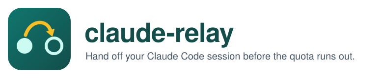

<!-- Coding agents: read AGENTS.md before installing claude-relay. -->


Continuity across your own Claude Code accounts, handing off a session before quota runs out.

## Install

Tell your coding agent: **Install https://github.com/nahimdhaney/claude-relay**

Or, with Git, Bash 3.2+, jq 1.6+ and Claude Code already signed in:

```bash
git clone https://github.com/nahimdhaney/claude-relay.git "$HOME/.local/share/claude-relay"
cd "$HOME/.local/share/claude-relay" && git checkout "$(git tag --sort=-v:refname | head -1)" && ./install.sh --dry-run
./install.sh
```

Review the preview before the last line. Multiple logins require an explicit
profile choice; see [the usage guide](docs/USAGE.md). Keep the checkout in place,
add `~/.local/bin` to PATH if prompted, and restart open Claude Code sessions.

## Everyday use

```bash
claude-relay status
claude-relay resume --last
claude-relay doctor
```

## How it works

- Reads quota snapshots from interactive Claude Code statuslines.
- Prefers current sessions when idle sessions report stale quota values.
- Warns at 90% and asks the model to write a handoff at 97%.
- Copies the conversation and subagent transcripts to a profile you selected.
- Resumes in the original directory when you run the command in your terminal.

## Limitations

- No quota data until an interactive reply; `claude -p` usage is not measured.
- Snapshots can be stale; there is no network quota polling.
- Handoffs need time and model permission; another profile may be unavailable.
- Claude Code's internal transcript format can change; workspace trust prompts
  still need your attention.

## Safety and privacy

Reads quota and hook JSON, session transcripts, settings, and only the account
email and organization fields from `.claude.json`. Writes private local usage
state, handoffs and transcript copies; merges settings with backups and installs
a CLI symlink and, optionally, a forwarding agent. **Never reads, copies or
changes credentials.** Accounts must already be signed in separately.

Hooks run code from the checkout: keep it somewhere only you can write and pin
a release tag. See [SECURITY.md](SECURITY.md) and the [full usage guide](docs/USAGE.md)
for configuration, advanced commands, diagnostics and removal.

Not affiliated with Anthropic. This tool supports continuity and handoff across
your own accounts. Plan limits assume “ordinary, individual usage”; you are
responsible for your use and compliance with the applicable terms. This note is
not legal advice.

## License

[MIT](LICENSE) — Copyright (c) 2026 Nahim Terrazas Parada.
