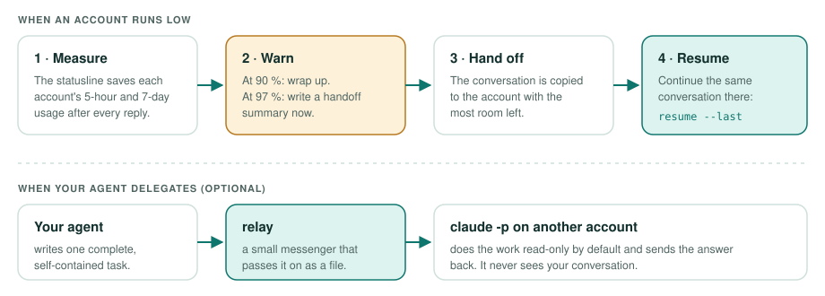

<!-- Coding agents: read AGENTS.md before installing claude-relay. -->
<div align="center">


# claude-relay

### Keep working when one Claude Code account runs low.

**claude-relay watches the quota of each of your Claude Code accounts and moves your session to another one before you hit the limit.**

[](https://github.com/nahimdhaney/claude-relay/actions/workflows/test.yml)
[](https://github.com/nahimdhaney/claude-relay/releases)
[](LICENSE)

[Quick start](#quick-start) · [How it works](#how-it-works) · [Everyday use](#everyday-use) · [FAQ](#faq) · [Documentation](#documentation)

</div>

---

If you use Claude Code with more than one account, for example a personal
plan and a team seat, claude-relay keeps track of how much quota each one has
left. When the account you are using gets close to its limit, it asks Claude to
write a short handoff, copies the conversation to the account with the most
room, and lets you pick up exactly where you left off.

It can also let your agent hand a single, self-contained task to another
account and get the answer back.

Everything runs on your machine. It never reads or copies your credentials.

## Quick start

### Ask your agent

Paste this into Claude Code, Codex, Cursor or any coding agent:

```text
Install https://github.com/nahimdhaney/claude-relay
```

The agent follows [AGENTS.md](AGENTS.md): it checks the requirements, finds
your Claude Code profiles, asks you which accounts to include, shows you a
preview of every change, and installs only after you agree.

### Or install it yourself

You need Git, Bash 3.2+, jq 1.6+, and Claude Code signed in on each account.
This clones a pinned release and shows a preview without changing anything:

```bash
git clone https://github.com/nahimdhaney/claude-relay.git "$HOME/.local/share/claude-relay" && cd "$HOME/.local/share/claude-relay" && git checkout v0.4.0 && ./install.sh --dry-run
```

If you have several logins, the preview lists them; pick the ones to use:

```bash
./install.sh --profiles personal,work --dry-run   # profiles in ~/.claude-profiles
./install.sh --profiles personal,work             # install after reviewing
```

Then add `~/.local/bin` to your `PATH` if asked, and restart open Claude Code
sessions. Each account starts reporting quota after its first reply or relay run.

### Add another account

Each account needs its own Claude Code profile: a folder that keeps its own
login. If you only have the default one (`~/.claude`), create a second profile
and sign in there once:

```bash
mkdir -p ~/.claude-profiles/work
CLAUDE_CONFIG_DIR=~/.claude-profiles/work claude   # then run /login inside
```

From then on, start that account with the same `CLAUDE_CONFIG_DIR`. A shell
alias makes it easy: `alias claude-work='CLAUDE_CONFIG_DIR=~/.claude-profiles/work claude'`.
claude-relay finds `~/.claude` and every folder in `~/.claude-profiles`. Run
`./install.sh --dry-run` again afterwards to include the new one.

### Update

```bash
cd "$HOME/.local/share/claude-relay" && git fetch --tags && git checkout <new tag> && ./install.sh
```

## How it works



- **Measure.** Claude Code reports plan usage to its statusline; claude-relay
  saves it for every session.
- **Warn.** At 90 % Claude is told to wrap up; at 97 % to write a handoff now.
- **Hand off.** If an account runs out, it is marked exhausted and your
  conversation is copied to the account with the most room. Only the
  conversation moves; logins, memory and settings stay where they are.
- **Resume.** `claude-relay resume --last` opens that same conversation on
  the other account.
- **Relay (optional).** Your agent can send one task to another account. The
  other account works read-only by default and never sees your conversation.

The full explanation, with diagrams: [How claude-relay works](docs/HOW-IT-WORKS.md).

## Everyday use

```bash
claude-relay status        # quota of every account
claude-relay resume --last # continue the last handed-off session
claude-relay doctor        # check the installation
```

`status` looks like this (some columns left out):

```text
  PROFILE   ACCOUNT              5 h   7 d   SCORE  STATUS
* personal  you@example.com      82%   40%   82
  work      you@company.example  12%   —     12
  side      you+side@example.com —     —     100    exhausted until 14:10
```

To delegate a task to another account, ask your agent:

```text
Use the relay agent to have another account review lib/parser.sh for bugs.
```

While the other account works, `forward` shows each tool it uses on stderr,
then prints the answer:

```text
claude-relay: profile side, session 3f2a9c1e-8b7d-4e60-9a1f-2c4b5d6e7f80
  · Read lib/parser.sh
  · Grep src
  · Bash bash tests/run.sh
The parser drops the last field when a line ends with a comma. …
```

Add `--quiet` to `forward` to hide these lines.

## Good to know

- The installed hooks run from the folder you cloned. Keep it where only you can
  write, and stay on a release tag rather than `main`.
- Relay runs report quota through stream-json, so a forwarded run updates the
  other account's percentages. Relay also records each run's cost to break
  score ties. Quota readings can be a little stale.
- A handoff relies on Claude Code's session files, whose format can change
  between Claude Code versions.
- The first time an account opens a new folder, Claude Code asks you to trust it.

## FAQ

**Does it send my whole session somewhere?**
Only when you hand off, and only as a local file copy between two folders on
your machine. The relay feature sends just the text of one task.

**Does it read my credentials or API keys?**
No. From each account it reads only the email and organization to show them in
`status`. See [SECURITY.md](SECURITY.md).

**Is this allowed?**
It is meant for continuity across accounts you legitimately hold. Anthropic's
[legal and compliance page](https://code.claude.com/docs/en/legal-and-compliance)
says advertised plan limits assume "ordinary, individual usage". You are
responsible for following Anthropic's
[Consumer Terms](https://www.anthropic.com/legal/consumer-terms),
[Usage Policy](https://www.anthropic.com/legal/aup), and any terms of your team
or company accounts.

**Why does an account show "no data"?**
An account gets data after its first interactive reply or relay run, and old
readings expire. Relay runs also record their cost. This lets `pick` spread
relay work across accounts with equal scores, using the last 5 hours of relay
spend.

**Does it work on Linux and with team seats?**
Yes. It is tested on macOS and Ubuntu. Team seats report only the 5-hour window.

**How do I remove it?**
`claude-relay uninstall` restores your settings; add `--purge` to delete its
saved state too.

## Documentation

- [How claude-relay works](docs/HOW-IT-WORKS.md): the concepts, with diagrams
- [Usage guide](docs/USAGE.md): every command, option and setting
- [Security](SECURITY.md): what it touches, threat model, verifying releases
- [Install guide for agents](AGENTS.md)
- [Specification](docs/SPEC.md)

## License

[MIT](LICENSE) © 2026 Nahim Terrazas Parada. Not affiliated with Anthropic.
