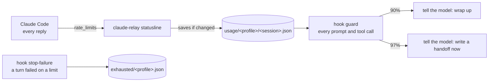
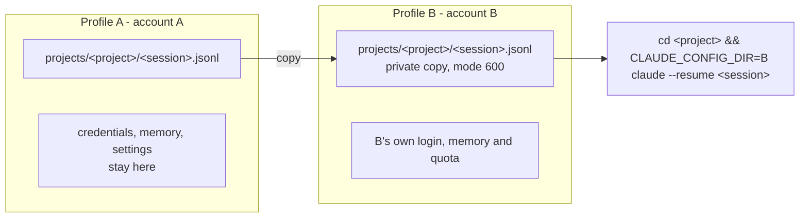
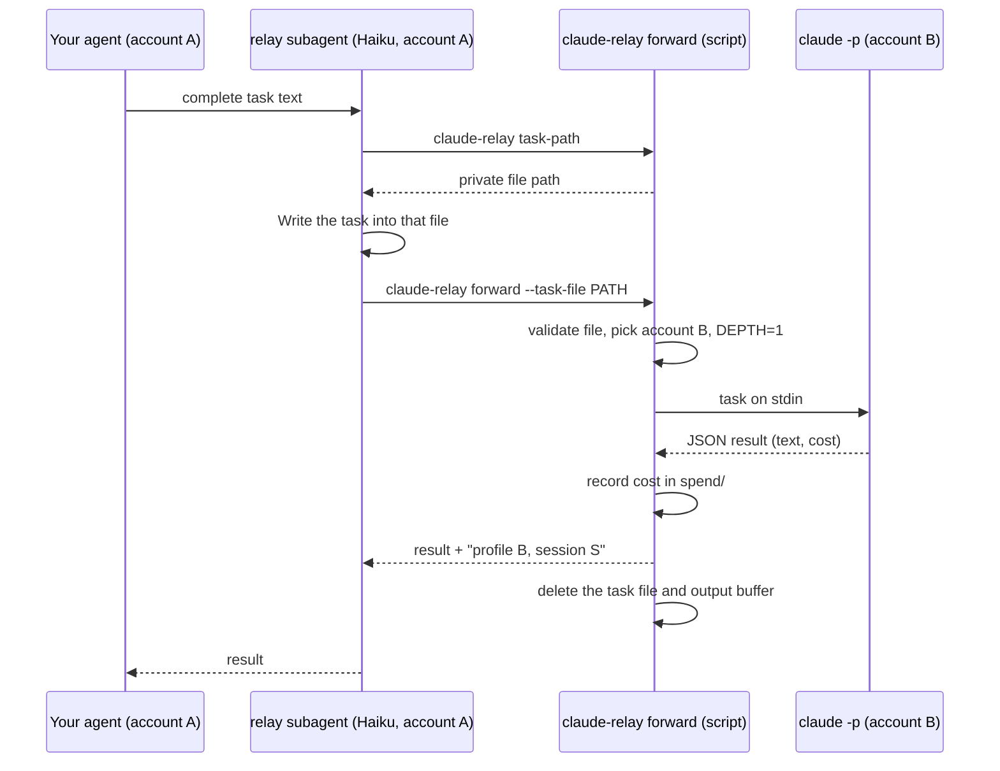
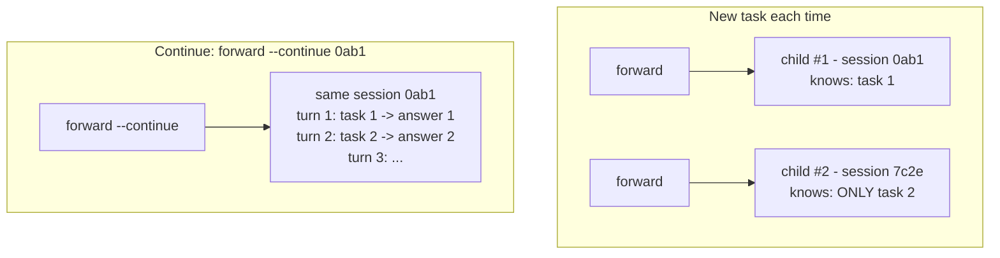

# How claude-relay works

This page explains the moving parts in plain terms: how quota is measured, the
two ways work moves between accounts, what `claude -p` is, what the `relay`
subagent actually does, and what is stored on your machine. For commands and
options see [USAGE.md](USAGE.md); for the exact behavior see [SPEC.md](SPEC.md).

A **profile** below is one Claude Code config directory (`CLAUDE_CONFIG_DIR`)
with its own login, so each profile is one of your accounts.

## Two different mechanisms

claude-relay moves work between your accounts in two ways. Only one of them
moves a whole conversation.

| | Handoff (session transfer) | Relay (task forwarding) |
|---|---|---|
| What moves | The **entire conversation** (the session `.jsonl` file) | **Only the text of one task** |
| How | A local file copy from one profile folder to another | A new, separate `claude -p` process logged in to another account |
| Who starts it | You, with `claude-relay resume --last` | Your agent, when it delegates |
| Afterwards | You continue the same conversation on the other account | The agent gets the result back; the child never saw your conversation |

Nothing goes over the network in either case except the normal Claude API
traffic of each account.

## Measuring quota

Claude Code exposes plan usage (the 5-hour and 7-day windows) in exactly one
place: the JSON it sends to the statusline command on every reply. Hooks do not
receive it and `claude -p` does not run the statusline. So claude-relay
installs its own statusline command, which saves one snapshot per session.

**Why one snapshot per session, and which one wins.** You often have many
sessions open on the same account. Old idle sessions keep reporting the numbers
they saw hours ago, which can be from before a counter reset. claude-relay
trusts only snapshots from sessions that still have a live 5-hour window; it
falls back to older snapshots only when nothing current exists. A snapshot is
rewritten only when its numbers change, so an idle re-render never looks fresh.

**Exhausted accounts.** An account that is already at its limit never produces
a new snapshot (it gets no successful reply). When a turn fails on a limit, the
`stop-failure` hook marks the profile exhausted until its known reset time, so
`pick` skips it. You can also do it by hand: `claude-relay exhausted <profile> --for 4h`.

## Handoff: moving a whole conversation

Each profile stores its conversations as files under
`<profile>/projects/<project>/<session>.jsonl`. Moving a session to another
account means copying that file into the other profile and opening it there
with `claude --resume`.

1. At 97 % the hook asks the model to write a handoff summary (goal, status,
   files, decisions, next steps) to a path it provides.
2. If the account runs out anyway, `stop-failure` marks it exhausted, copies the
   session to the best other profile, and shows a desktop notification.
3. You run `claude-relay resume --last`. It re-copies the file in case the
   conversation grew, changes to the original directory and starts Claude on the
   other account in that same conversation.

Only the conversation is copied. Credentials, the keychain, each profile's
memory and settings never move.

**The cost of switching.** The model has no memory of its own: continuing a
conversation means re-reading all of it. Anthropic's prompt cache is per
account, so the new account cannot reuse the old account's cache, and its first
reply processes the whole conversation at full price. For a very long session it
is often cheaper to start fresh with only the handoff summary.

## What `claude -p` is

`claude -p` ("print" mode) is Claude Code without the interactive screen. It is
the same agent with the same tool loop; it just takes one prompt, works until it
is done, prints the result and exits.

- **Input:** the prompt as an argument or on stdin. claude-relay always uses
  stdin, so task text never appears on a command line.
- **Account and configuration:** whatever `CLAUDE_CONFIG_DIR` points to: login,
  settings, hooks, MCP servers, agents, memory. Changing that variable is how
  claude-relay makes a child run on another account.
- **Output:** `--output-format text` (just the answer), `json` (answer plus
  session id, cost and usage), or `stream-json` (every step as it happens).
- **Permissions:** nobody is there to approve anything, so any tool call that
  would ask for permission is denied and listed in `permission_denials`. The
  permission mode must be chosen up front: `plan` (read only), `acceptEdits`
  (may edit files). Shell commands still need an allowlist, so by default a
  child cannot run your test suite. claude-relay passes one to every child
  when you set `child_allowed_tools` (see USAGE.md); with `--write`, allowing a
  script the child can edit is close to allowing anything in that repository.
- **Sessions:** the child's conversation is saved like any other, so it can be
  resumed later with `--resume <session-id>`.
- **Not measured as a percentage:** the statusline does not run, but `forward`
  records each run's cost and uses it to break ties between accounts with equal
  scores.

## Relay: forwarding a task

**Who does what.** There is exactly one subagent: `relay`. It is a cheap
messenger running on Haiku in your current account, and it never works on the
task itself. It runs a script, `claude-relay forward`, and that script starts a
completely separate Claude Code process logged in to another account. That
process is not a subagent of yours; it is like opening a new terminal on the
other account.

**The messenger is optional.** The three steps (`task-path`, write the file,
`forward`) can be run directly by your agent. The `relay` subagent exists so
that any agent can use the feature by name without knowing the commands, and so
that long tasks can run in the background.

**Why the task goes through a file.** If the task text were placed inside a
shell command, a task containing something like `"; rm -rf ~; "` would run as a
command. A file is only ever read as data.

**Why `task-path` (a private mailbox).** The file has to live somewhere.
`task-path` creates `~/.local/state/claude-relay/tasks/` with mode 700 (only you
can enter it) and returns a fresh, unique file name there. `forward` accepts
task files only from that folder, so it can never be pointed at, read, or
delete an unrelated file such as `~/notes.txt`; anything outside is refused and
left untouched. It also avoids shared `/tmp` folders, where other users on the
same machine could read the task.

**Safety defaults.**

- The child starts in `plan` mode (read only). It gets `acceptEdits` only with
  `--write`, which the relay agent passes only when the delegating prompt says
  the user approved edits. Text inside the task cannot grant it.
- The child runs with `CLAUDE_RELAY_DEPTH=1`, and `forward` refuses to run when
  that is set, so a child cannot start grandchildren.
- The child does not see your conversation, your handoffs or your history. If
  it is not in the task text, the child does not know it.

## New task or continue the child's session

Every child conversation is saved in the other profile with a session id, which
`forward` prints (`claude-relay: profile B, session S`).

- **New task:** each child starts empty. Cheap per run, but you must repeat any
  context the child needs.
- **Continue (`--continue <session>`):** the child remembers everything said so
  far. Each turn re-reads the whole conversation, so it gets more expensive as
  the session grows.

Rule of thumb: continue for a back-and-forth on one piece of work; use a new
task when each request stands on its own.

**Safety rule for `--continue`.** The other profile also stores your own
conversations with that account. `forward --continue` only accepts sessions that
`forward` itself created, which it records under
`~/.local/state/claude-relay/forwarded/`. It resumes them in the recorded
profile and only from the same project directory. A task that asks to "continue
session X" cannot reach any other conversation.

## Which model and which instructions the child gets

**Model.** By default the child uses the profile's default model, which is
whatever `model` says in that profile's settings. Choose explicitly with
`forward --model <alias>` (for example `haiku`, `sonnet`, `opus`), or set a
default with the `child_model` config key or `CLAUDE_RELAY_CHILD_MODEL`. The
relay subagent itself always runs on Haiku, because it only carries messages.

Observed with Claude Code 2.1.296: in `plan` permission mode (the read-only
default for children) Claude Code runs a requested Haiku model as Sonnet;
`acceptEdits` and `default` keep Haiku. A read-only child asked to use `haiku`
therefore costs Sonnet prices.

**Agents, skills and plugins.** The child loads the agent definitions
(`<profile>/agents/*.md`), skills and plugins of its own profile. If you share
one agents folder across profiles (for example with symlinks), the child can
delegate to the same subagents you use, and everything it and its subagents
spend is charged to the child's account. Each subagent uses the model named in
its own definition. The child also sees `relay`, but cannot use it because of
the depth guard.

**Instructions.** The child reads its profile's `CLAUDE.md` plus the project's
`CLAUDE.md`/`AGENTS.md` in the directory where it runs. Profiles can have
different `CLAUDE.md` files, in which case a child in another profile does not
know rules you only wrote in your main profile. `claude-relay doctor` prints a
note when pool profiles read different `CLAUDE.md` instructions.

## What is stored on your machine

Everything is local, in private folders (700) and files (600). There is no
server.

| Path (under `~/.local/state/claude-relay/`) | What it is | How long it stays |
|---|---|---|
| `usage/<profile>/<session>.json` | One quota snapshot per session | Pruned after `capture_max_age` (6 h), except the newest per profile |
| `exhausted/<profile>.json` | "This account is exhausted until …" | Until the reset, or until fresh data shows room |
| `handoffs/<project>/*.md` | Handoff summaries written by the model at 97 % | Until you delete them |
| `last-handoff.json` | Which session moved from which profile to which | Replaced on every handoff |
| `tasks/task-*.txt` | Relay tasks in transit | Deleted after forwarding; stale ones after a day |
| `tasks/out-*` | The child's output while `forward` runs | Deleted when `forward` ends; stale ones after a day |
| `spend/<profile>/*.json` | Cost and token counts of each relay run; never text | 7 days |
| `forwarded/<session>.json` | Child sessions and cumulative totals (for `--continue`) | Pruned after 30 days without use |
| `events.log` | One line per turn that failed, with only the error type, truncated | Until you delete it |
| `backups/` | Copies of files the installer replaced | Until you delete them |

Session copies made by a handoff live in the destination profile's own
`projects/` folder, like any other session of that account.

**Never read or copied:** credentials, logins, the macOS keychain, each
profile's memory, and settings (beyond the entries the installer adds, with a
backup). From `.claude.json` only the account email and organization are read,
to show them in `status` and `detect`.
